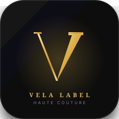
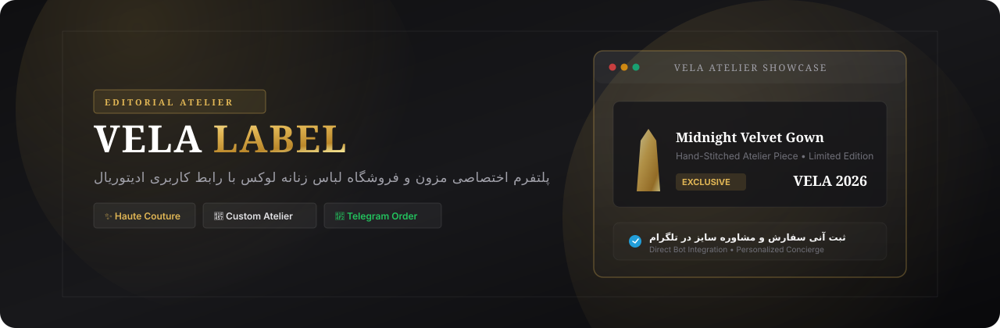

<div align="center">

  

  # 👗 VELA LABEL (New Editorial UI)
  ### پلتفرم ادیتوریال و فروشگاه مدرن مزون لباس زنانه لوکس با بازطراحی مینیمال سوییسی
  *Haute Couture & Luxury Women's Atelier E-Commerce (New Editorial UI/UX Redesign)*

  <br />

  

  [](https://react.dev)
  [](https://vitejs.dev)
  [](src)
  [](telegram-bot)
  [](LICENSE)

</div>

<br />

> ### 🏛 هنر خیاطی دست‌دوز و طراحی ادیتوریال
> <div dir="rtl" align="right">
>
> **VELA LABEL** برآمده از تلفیق ظرافت بی‌بدیل مد سطح بالا (Haute Couture)، استانداردهای جهانی طراحی گرافیک سوییسی (Swiss Typographic Grid) و توسعه وب مدرن است. این پلتفرم فضایی گالری‌گونه برای معرفی کلکسیون‌های فصلی، لباس‌های شب انحصاری و ایجاد ارتباط مستقیم میان مشتریان خاص و مزون از طریق ربات تلگرام فراهم می‌سازد.
> 
> *Editorial luxury e-commerce experience fusing warm monochrome aesthetics, bespoke garment ordering, and Telegram concierge integration.*
> </div>

---

<div dir="rtl" align="right">

## 📖 معرفی پلتفرم مزون

این پروژه یک وب‌اپلیکیشن فروشگاهی لوکس است که تجربه خرید لباس‌های انحصاری را از یک فروشگاه سنتی به یک بازدید دیجیتال از گالری مد ارتقا می‌دهد. کاتالوگ لباس‌ها با عکس‌های ادیتوریال باکیفیت، مشخصات پارچه، راهنمای جامع سایزبندی سفارشی و قابلیت انتقال مستقیم به کانال ارتباطی مزون در تلگرام پیاده‌سازی شده است.

### 🌟 تمایزهای کلیدی تجربه کاربری:
- **طراحی ادیتوریال مینیمال (Swiss Typographic Layout):** استفاده از تایپوگرافی سریف کلاسیک برای عناوین، خطوط باریک هندسی، سایه‌های نرم مخملی و پالت رنگی گرم خاکستری تیره و طلایی لوکس.
- **ربات اختصاصی سفارش‌گیری در تلگرام (`telegram-bot/`):** اتصال خودکار اطلاعات سبد خرید و سایزهای اندازه‌گیری‌شده کاربر به ربات پشتیبان مزون جهت هماهنگی و پرو حضوری.
- **کاتالوگ پویا و فیلترهای پیشرفته:** دسته‌بندی بر اساس نوع کلکسیون (لباس شب، کت‌ودامن مزونی، پیراهن‌های فرمال) به همراه برچسب‌های وضعیت موجودی.
- **توابع ابری بدون سرور (`functions/`):** پردازش امن هوک‌ها و ارسال سفارشات بدون نیاز به سرورهای سنگین.
- **سرعت فوق‌العاده با Vite و TypeScript:** لودینگ فوری تصاویر، ترنزیشن‌های حرکتی روان و عدم استفاده از المان‌های بصری سنگین و شلوغ.

</div>

---

## ✨ جدول قابلیت‌ها و امکانات

| ردیف | بخش | شرح قابلیت به فارسی | English Feature Description |
| :---: | :--- | :--- | :--- |
| ۱ | **کلکسیون مد (Lookbook)** | نمایش گالری لباس‌ها با اسلایدرهای نرم و زوم ادیتوریال | High-resolution editorial fashion gallery and seasonal lookbooks |
| ۲ | **سفارش تلگرامی (Concierge)** | ارسال مستقیم فرم اندازه و مدل انتخابی به بات تلگرام مزون | Direct-to-Telegram order submission with custom sizing measurements |
| ۳ | **راهنمای سایز (Size Guide)** | جدول استاندارد اندازه‌گیری دور سینه، کمر و قد برای دوخت سفارشی | Interactive haute couture custom tailoring sizing matrix |
| ۴ | **توابع سرورلس (Functions)** | پردازش هوک‌ها و ارتباط با تلگرام API در دایرکتوری `functions/` | Cloudflare / Edge serverless functions for event dispatching |
| ۵ | **امنیت متغیرها (Config)** | ایزولاسیون کامل توکن‌ها با ساختار امن `.env.example` | Clean environment template preventing API token leakage |
| ۶ | **سیستم تمینگ تاریک لوکس** | ترکیب رنگی مشکی بازالتی، کنتراست تایپوگرافی عاجی و ورق طلا | Bespoke dark luxury palette with gold accents and tactile hover states |

---

<div dir="rtl" align="right">

## 🏛 معماری نرم‌افزار و پشته سیستم

معماری پلتفرم VELA LABEL بر تفکیک کامل فرانت‌اند ادیتوریال و سرویس‌های پشتیبان تلگرام استوار است:

```
┌────────────────────────────────────────────────────────┐
│             Frontend UI (React 18 + Vite)              │
│     Pages: Collection, Lookbook, Custom Order, Cart    │
│     Components: ProductGrid, SizeModal, AtelierHeader  │
└───────────────────────────┬────────────────────────────┘
                            │ [Telegram Bot API & Webhooks]
┌───────────────────────────▼────────────────────────────┐
│             Serverless Functions & Bot Core            │
│     functions/ (Event Handlers) & telegram-bot/        │
└───────────────────────────┬────────────────────────────┘
                            │ [Notification Pipeline]
┌───────────────────────────▼────────────────────────────┐
│             Atelier Concierge & Management             │
│     Direct messaging to atelier tailors & managers     │
└────────────────────────────────────────────────────────┘
```

</div>

---

<div dir="rtl" align="right">

## 🔒 امنیت و حریم خصوصی

- **عدم نشت توکن‌های تلگرام:** کلیه توکن‌های ارتباطی بات در `.gitignore` ایمن‌سازی شده و نمونه پیکربندی در `.env.example` ارائه گردیده است.
- **حفظ حریم خصوصی اندازه‌های شخصی:** ابعاد و مشخصات سفارشی کاربران تنها برای مشاور مزون ارسال شده و عمومی نمی‌گردد.

</div>

---

## 🛠 مشخصات و پشته فنی (Tech Stack)

| حوزه | تکنولوژی | کاربرد در سیستم |
| :--- | :--- | :--- |
| **Frontend Core** | React 18 + TypeScript | مدیریت وضعیت اعلانی و تایپ‌ایمن |
| **Bundler & Tooling** | Vite 5 | توسعه سریع و خروجی سبک و بهینه |
| **Typography & Styling** | Editorial CSS / Tailwind | استایل‌های سفارشی با فونت‌های سریف لوکس |
| **Telegram Integration** | Telegram Bot API | سیستم پشتیبانی و دریافت سفارشات |
| **Backend Functions** | Cloud Functions / Edge | توابع بدون سرور برای پردازش درخواست‌ها |

---

<div dir="rtl" align="right">

## 📦 راهنمای نصب و اجرای پروژه

### ۱. دریافت مخزن:
```bash
git clone https://github.com/NarimanMoazeni/VELA-LABEL-NEW-UI.git
cd VELA-LABEL-NEW-UI
```

### ۲. تنظیم متغیرهای محیطی:
یک کپی از فایل نمونه `.env.example` ایجاد کنید:
```bash
cp .env.example .env
```
محتوای `.env`:
```env
VITE_TELEGRAM_BOT_TOKEN=your_telegram_bot_token_here
```

### ۳. نصب وابستگی‌ها و اجرا:
```bash
# نصب پکیج‌ها
npm install

# اجرای سرور توسعه محلی
npm run dev

# بیلد نهایی پروژه
npm run build
```

</div>

---

## 📁 ساختار پوشه‌ها و کدهای منبع

```plaintext
VELA-LABEL-NEW-UI/
├── docs/images/          # لوگوی برداری طلایی و بنر ادیتوریال
├── functions/            # توابع ابری بدون سرور (Cloud Functions)
├── public/               # دارایی‌های استاتیک و آیکون‌ها
├── src/
│   ├── components/       # کامپوننت‌های مدرن مزون (گالری، فرم ثبت سفارش)
│   ├── types/            # تعاریف داده‌ای تایپ‌اسکریپت
│   ├── App.tsx           # روت و قالب اصلی برنامه
│   └── main.tsx          # نقطه ورود کلاینت React
├── telegram-bot/         # ماژول و فایل‌های اتصال به بات تلگرام
├── .env.example          # قالب امن تنظیمات محیطی
├── package.json          # پیکربندی پکیج‌ها و اسکریپت‌ها
├── tsconfig.json         # تنظیمات کامپایلر تایپ‌اسکریپت
└── vite.config.ts        # تنظیمات سرور بیلد Vite
```

---

## 📄 لایسنس و حقوق کپی‌رایت

سامانه **VELA LABEL** تحت مجوز رسمی [MIT License](LICENSE) منتشر شده است.

<br />

<div align="center">
  <sub>Haute Couture Digital Experience • Crafted with Pure Architectural Elegance ✨</sub>
</div>
